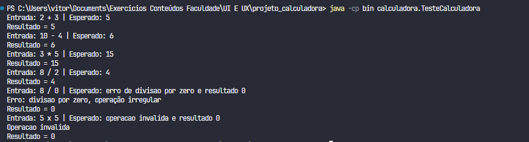
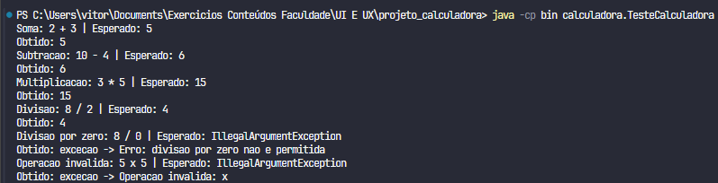
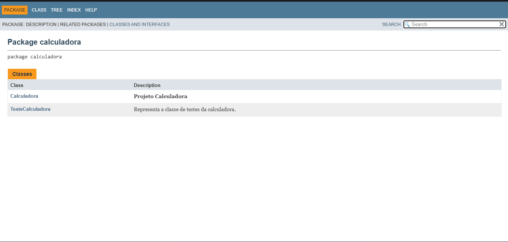
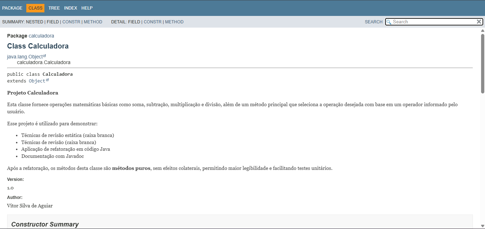

# Projeto Calculadora — FinançApp

> Projeto acadêmico desenvolvido com foco em Qualidade de Software, Testes, Refatoração, Documentação e Versionamento.

---

## 1. Identificação do Projeto

**Projeto:** Projeto Calculadora
**Contexto:** FinançApp
**Aluno:** Vítor Silva de Aguiar
**RA:** 252264
**Curso:** Análise e Desenvolvimento de Sistemas
**Disciplina:** UI/UX e Testes de Software
**Professor:** Daniel Ohata
**Semestre:** 2026.2

---

## 2. Descrição do Projeto

O projeto consiste no desenvolvimento de um módulo de cálculos matemáticos básicos em Java para a startup fictícia **FinançApp**, com soma, subtração, multiplicação e divisão, tratamento de divisão por zero e de operadores inválidos.

## 3. Objetivo da Atividade

Desenvolver uma calculadora em Java aplicando práticas de testes funcionais, refatoração, documentação técnica com JavaDoc e versionamento com Git e GitHub.

## 4. Tecnologias Utilizadas

| Tecnologia | Versão | Utilização |
|---|---|---|
| Java | 21 | Desenvolvimento |
| JDK | 21 | Compilação |
| Git | 2.53.0.windows.1 | Controle de versão |
| GitHub | — | Repositório remoto |
| JavaDoc | — | Documentação HTML |
| IDE | Visual Studio Code | Ambiente de desenvolvimento |

## 5. Explicação das Operações

| Operação | Operador | Comportamento |
|---|---|---|
| Soma | `+` | Retorna `a + b` |
| Subtração | `-` | Retorna `a - b` |
| Multiplicação | `*` | Retorna `a * b` |
| Divisão | `/` | Retorna `a / b`; lança `IllegalArgumentException` se `b` for zero |
| Inválida | qualquer outro | Lança `IllegalArgumentException` |

## 6. Testes

### 6.1 Versão original (branch `main`)



### 6.2 Versão refatorada (branch `Refatoracao`)



## 7. Refatoração

Na branch `Refatoracao` foram aplicadas as seguintes técnicas:

- **Extração de métodos:** as operações passaram a ser métodos próprios (`somar`, `subtrair`, `multiplicar`, `dividir`).
- **Simplificação condicional:** a cadeia de `if/else` foi substituída por um `switch`.
- **Melhoria de nomes:** o método `calc` virou `calcular`, e o operador passou a se chamar `operador`.
- **Remoção de efeitos colaterais:** o atributo `r` e os `println` da lógica foram removidos; o resultado agora é retornado.
- **Tratamento de erros:** divisão por zero e operador inválido lançam `IllegalArgumentException`, em vez de imprimir mensagem e retornar zero.

## 8. Documentação JavaDoc

A documentação HTML foi gerada na pasta `docs/`. Para visualizá-la, abra `docs/index.html` no navegador.





## 9. Estrutura do Projeto

```text
projeto_calculadora/
├── src/calculadora/Calculadora.java
├── test/calculadora/TesteCalculadora.java
├── docs/index.html
├── images/
│   ├── testes/
│   ├── javadoc/
│   └── refatoracao/
├── README.md
└── .gitignore
```

## 10. Repositório

Link do repositório: https://github.com/vitor-ag/projeto_calculadora

## 11. Como executar

```bash
javac -encoding UTF-8 -d bin src/calculadora/Calculadora.java test/calculadora/TesteCalculadora.java
java -cp bin calculadora.TesteCalculadora
```